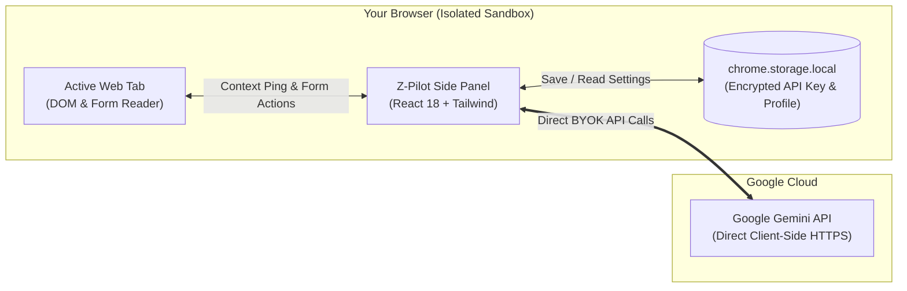

<p align="center">
  
</p>

<h1 align="center">Z-Pilot: Autonomous AI Browser Agent</h1>

<p align="center">
  <b>Serverless AI Web Copilot for Chrome & Brave • Powered by Google Gemini</b><br>
  <i>Control your browser, summarize pages, automate web forms, and search multimedia with natural language.</i>
</p>

<p align="center">
  <a href="https://raw.githubusercontent.com/zeesu-royalist/Z-Pilot-Chrome-Extension/main/release/z-pilot-v1.0.0.zip"></a>
  <a href="#-key-features"></a>
  <a href="#-architecture--privacy-first"></a>
  <a href="https://aistudio.google.com/"></a>
  <a href="#-tech-stack"></a>
  <a href="https://zeesu-royalist.vercel.app"></a>
</p>

---

## 🌟 Overview

**Z-Pilot** is an autonomous browser side-panel assistant designed to turn your Chrome or Brave browser into an intelligent workspace. Instead of copying and pasting text into separate AI chatbots, **Z-Pilot lives directly inside your browser side panel**, securely aware of the active tab's context.

From reading complex documentation and extracting bullet summaries, to finding and playing your favorite music on YouTube, to safely autofilling long checkout and signup forms with **Human-in-the-Loop 1-click approvals** — Z-Pilot handles tedious browser workflows seamlessly.

> **Zero Backend Required:** 100% serverless. You never pay for or maintain a server. Every user brings their own free Google Gemini API key (BYOK), which is stored strictly on their device.

---

## ⚡ Key Features

| Feature | Description |
| :--- | :--- |
| 📄 **Instant Page Summarization** | Reads article/docs text from the active tab and generates crisp bullet-point takeaways. |
| 🌐 **Website Explainer** | Ask *"Explain this website"* to receive a high-level breakdown of the site's purpose and target audience. |
| ✍️ **Safe Form Autofill** | Detects input fields on signups, registrations, and checkouts. Previews field values for **1-click approval** before typing. |
| 🎵 **YouTube Automation** | Say *"Play lo-fi chill beats on YouTube"* to open search results and trigger playback automatically. |
| 🛡️ **100% Client-Side Privacy** | Zero external servers or tracking. Direct HTTPS communication between your browser and Google AI Studio. |
| 🔥 **Ember Flame UI Theme** | Built with an ultra-sleek, dark frosted-glass aesthetic tailored with glowing amber & flame accents. |

---

## 🏗️ Architecture & Privacy-First Security

Traditional AI extensions pipe your web page data through an untrusted third-party proxy server. **Z-Pilot is fundamentally different.**



### Security Guarantees:
1. **Zero Intermediate Servers:** No API middleman, no logging server, and zero telemetry collection.
2. **BYOK (Bring Your Own Key):** Stored only in `chrome.storage.local`.
3. **Consequential Action Previews:** Form submissions and navigation requests require explicit user confirmation via the **Approve & Execute** card.
4. **Restricted Domain Guard:** Blocked from executing on internal browser pages (`chrome://`, `chrome-extension://`, `about:`).

---

## 🚀 Installation & Setup

### ⚡ Option 1: Instant Install (No Coding / No Node.js Needed!) — Recommended

For users who want to install and use Z-Pilot immediately without touching any code or terminal:

<p align="center">
  <a href="https://raw.githubusercontent.com/zeesu-royalist/Z-Pilot-Chrome-Extension/main/release/z-pilot-v1.0.0.zip">
    
  </a>
</p>

#### 3-Step Setup:
1. **Download & Extract:** 
   Click the button above to download **`z-pilot-v1.0.0.zip`**. Unzip it on your computer — you will get a folder named **`z-pilot-extension`**.
2. **Open Extensions in Chrome or Brave:**
   - Navigate to `chrome://extensions` (or `brave://extensions`).
   - Turn **ON** the **Developer mode** toggle in the top-right corner.
3. **Load Extension:**
   - Click the **"Load unpacked"** button in the top-left corner.
   - Select the unzipped **`z-pilot-extension`** folder.
   - 🎉 **Done!** Click the puzzle icon (🧩) in your browser toolbar and **Pin 📌 Z-Pilot** to your browser.

---

### 🛠️ Option 2: Build from Source (For Developers)

If you would like to inspect, customize, or contribute to the code:

```bash
# 1. Clone the repository
git clone https://github.com/zeesu-royalist/Z-Pilot-Chrome-Extension.git
cd Z-Pilot-Chrome-Extension/extension

# 2. Install dependencies
npm install

# 3. Build the production bundle
npm run build
```

Then load the generated **`extension/dist`** folder via `chrome://extensions` using **Load unpacked**.

---

### 🔑 Connecting Your Free Gemini API Key

1. Click the **Z-Pilot** icon in your toolbar to open the Side Panel.
2. Click **Get free key** or click the **Settings ⚙️** icon in the top right.
3. Paste your free Gemini API key and click **Save Key**.
4. *(Optional)* Click **Test Connection** to verify your key instantly!

> 💡 **Need an API Key? (4 Easy Steps):**
> 1. Visit [Google AI Studio](https://aistudio.google.com/app/apikey).
> 2. Sign in with your standard Google / Gmail account.
> 3. Click the blue **"Create API Key"** button.
> 4. Copy your key and paste it into Z-Pilot Settings! (100% Free, no credit card required).

---

## 🎯 Example Prompts to Try

Open any website, click Z-Pilot in the side panel, and try:

* 📄 **Summarization:**
  > *"Summarize this webpage and give me the top 3 insights."*
* 🌐 **Site Understanding:**
  > *"Explain what this website does and who it is built for."*
* ✍️ **Form Autofill:**
  > *"Scan this page and help me fill out the registration form with my saved profile."*
* 🎵 **Media Playback:**
  > *"Play Believer on YouTube."*
* 🔍 **Research:**
  > *"Search Google for latest developer updates on WebAssembly."*

---

## 📁 Repository Structure

```text
Z-Pilot/
├── release/                         # 📦 Pre-packaged ready-to-install ZIP
│   └── z-pilot-v1.0.0.zip
├── extension/                       # 🚀 Chrome Extension (Manifest V3)
│   ├── public/
│   │   ├── icons/                   # Extension icons (16, 32, 48, 128px)
│   │   ├── brand-mark.png           # Transparent brand logo
│   │   ├── logo.png                 # Official banner logo
│   │   └── manifest.json            # MV3 configuration
│   ├── src/
│   │   ├── components/              # Premium React UI Components
│   │   │   ├── ActionPreview.tsx    # Approve & Execute confirmation card
│   │   │   ├── BrandLogo.tsx        # Authentic brand assets
│   │   │   ├── ChatInput.tsx        # Capsule input bar with optical centering
│   │   │   ├── ChatMessage.tsx      # Frosted glass message bubbles
│   │   │   ├── ChatWindow.tsx       # Conversation history container
│   │   │   ├── Header.tsx           # Navigation & creator links
│   │   │   ├── ProfileModal.tsx     # Autofill contact information manager
│   │   │   ├── SettingsPanel.tsx    # API key, model selector & (i) guide
│   │   │   └── WelcomeScreen.tsx    # Hero greeting & action cards
│   │   ├── content/                 # Webpage DOM reader & form executor
│   │   │   └── content-script.ts
│   │   ├── services/                # Core logic & client-side services
│   │   │   ├── agent-planner.ts     # Safe plan parser & validator
│   │   │   ├── browser-actions.ts   # Tab control, YouTube & DOM driver
│   │   │   ├── gemini-client.ts     # Direct Google Gemini API connector
│   │   │   └── storage.ts           # chrome.storage.local wrapper
│   │   ├── styles.css               # Ember Flame design system
│   │   └── App.tsx                  # Main application orchestrator
│   ├── package.json
│   ├── tsconfig.json
│   └── vite.config.ts
└── README.md
```

---

## 🛠️ Tech Stack & Engineering Highlights

* **Frontend:** [React 18](https://react.dev/) + [TypeScript](https://www.typescriptlang.org/)
* **Styling:** [Tailwind CSS](https://tailwindcss.com/) with a curated Ember Flame color palette (`#EA580C`, `#F97316`, `#FB923C`) and dark glassmorphic styling
* **Icons:** [Lucide React](https://lucide.dev/) with optically balanced alignment
* **Bundler:** [Vite 6](https://vitejs.dev/) with Rollup extension build pipeline
* **AI Model Support:** `gemini-3.5-flash-lite` (Default & Fastest), `gemini-3.5-flash`, `gemini-2.5-flash-lite` with automatic fallback

---

## ❓ Frequently Asked Questions (FAQ)

<details>
<summary><b>Is Z-Pilot free to use?</b></summary>
Yes! Z-Pilot is 100% open-source and free. Google provides a generous free tier for the Gemini API that gives plenty of daily requests for personal browsing.
</details>

<details>
<summary><b>Does Z-Pilot collect my browsing history or passwords?</b></summary>
<b>No.</b> Z-Pilot has no analytics or third-party servers. Passwords, PINs, and credit card fields are strictly excluded from autofill. All data is processed on-device and transmitted only to Google's official Gemini endpoint.
</details>

<details>
<summary><b>Can I choose which Gemini model to use?</b></summary>
Yes. In the Settings panel (⚙️), you can switch between <code>gemini-3.5-flash-lite</code> (fastest & recommended), <code>gemini-3.5-flash</code>, and <code>gemini-2.5-flash-lite</code>.
</details>

<details>
<summary><b>Does it work on Brave Browser?</b></summary>
Yes! Since Brave is Chromium-based, Z-Pilot loads seamlessly into Brave via <code>brave://extensions</code> with full side-panel support.
</details>

---

## 👤 Author & Creator

Crafted with ❤️ by **Zeesu Royalist**

* 🌐 **Portfolio & Website:** [zeesu-royalist.vercel.app](https://zeesu-royalist.vercel.app)
* 🐙 **GitHub:** [@zeesu-royalist](https://github.com/zeesu-royalist)

---

## 📄 License

This project is licensed under the **MIT License** — feel free to use, customize, and share it!
